<div align="center">

<picture>
  <source media="(prefers-color-scheme: dark)" srcset="docs/assets/logo-dark.svg">
  
</picture>

**A real-time collaborative whiteboard that runs entirely on Cloudflare's free plan.**

Infinite canvas, live cursors, offline edits, sharing, PDFs and templates, with $0 hosting and no servers that sleep.

[](https://github.com/AnasSAV/Canvasly/actions/workflows/ci.yml)
[](https://github.com/AnasSAV/Canvasly/actions/workflows/codeql.yml)
[](https://github.com/AnasSAV/Canvasly/releases)
[](LICENSE)
[](tsconfig.base.json)
[](docs/DEPLOYMENT.md)

[**Live site**](https://canvasly.anas-hussaindeen.com) · [User guide](docs/USER_GUIDE.md) · [Architecture](docs/ARCHITECTURE.md) · [Deployment](docs/DEPLOYMENT.md) · [Changelog](CHANGELOG.md)

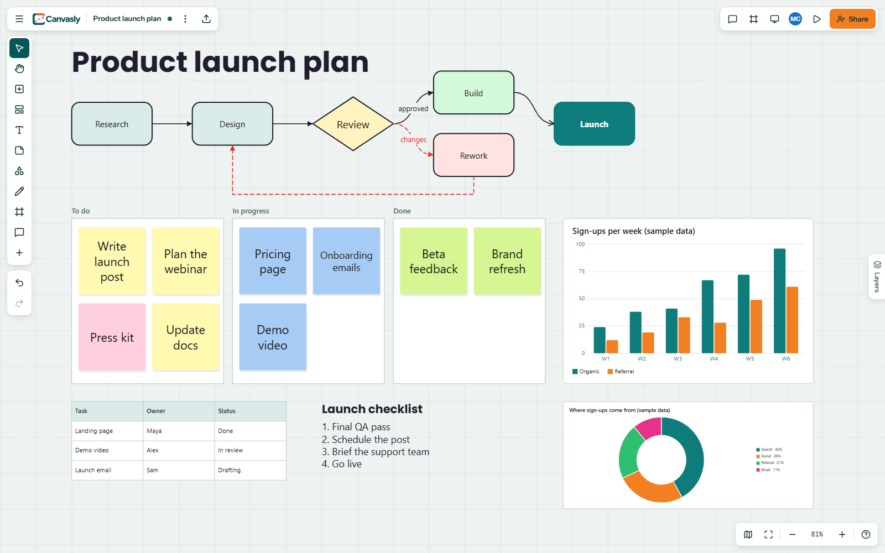

</div>

## Why Canvasly

- **Truly collaborative.** Every edit merges through a CRDT, so people can work on one board at once, and even offline,
  without conflicts.
- **Free to host, for real.** One Worker, one database and one Durable Object per board, all within the Workers Free plan,
  with no payment method on file.
- **Built to be read.** Strict TypeScript throughout, 207 automated tests, and the reasoning behind each decision written
  down in the [architecture notes](docs/ARCHITECTURE.md).

## Features

| Area              | What you get                                                                                         |
| ----------------- | ---------------------------------------------------------------------------------------------------- |
| **Canvas**        | Infinite zoom and pan, 18 shapes with corner rounding, stickies, frames, tables, bar to donut charts |
| **Text**          | Boxes that fit their content, 28 fonts, formatting, lists, links, highlights, keyboard shortcuts     |
| **Lines**         | One-drag connect dots; straight, elbow and curved routes; five end styles, dashes, bends, labels     |
| **Drawing**       | Pen and highlighter with custom-color presets, smart shape recognition, two erasers, lasso           |
| **Files**         | Drag and drop images and PDFs, page turning, page extraction, PNG, PDF and JSON export               |
| **Collaboration** | Live cursors, presence, follow mode, comments, per-user undo, offline edits that merge later         |
| **Sharing**       | Owner, editor and viewer roles enforced on the server, invites, public and editor links              |
| **Organizing**    | Figma-style layers with collapsible groups, 15 templates, presentation mode, minimap                 |
| **Interface**     | Dark mode, touch and phone support, right-click menus, paste from other apps including Canva         |

## Screenshots

<table>
  <tr>
    <td width="50%">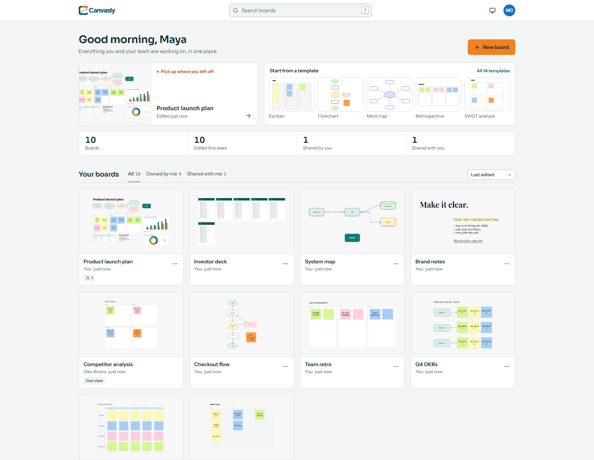<br><b>Home:</b> real numbers, and your latest board one click away</td>
    <td width="50%">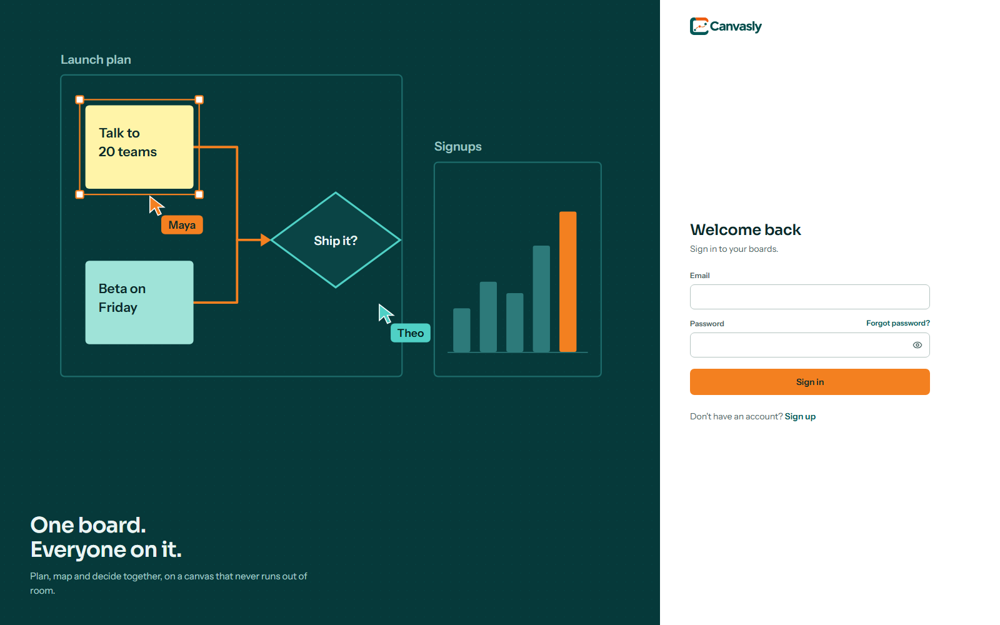<br><b>Sign in:</b> email and password, or Google</td>
  </tr>
  <tr>
    <td>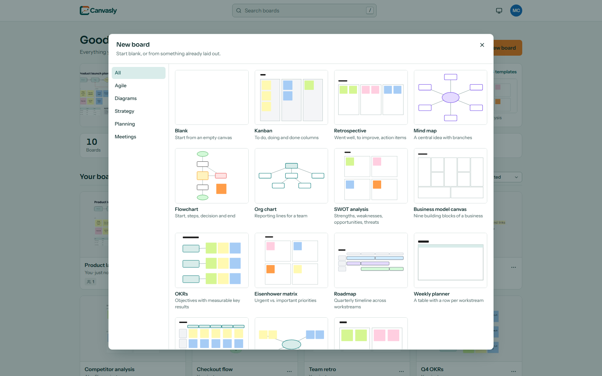<br><b>Templates:</b> start blank, or from something laid out</td>
    <td>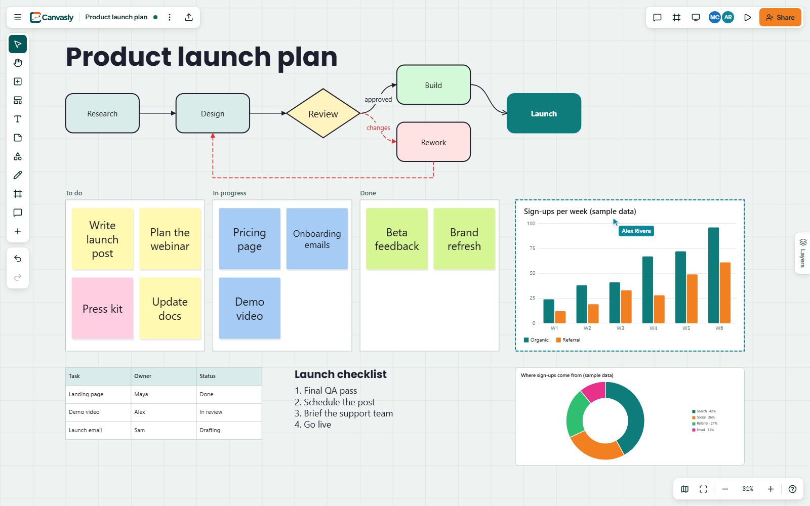<br><b>Collaboration:</b> live cursors and selections</td>
  </tr>
  <tr>
    <td>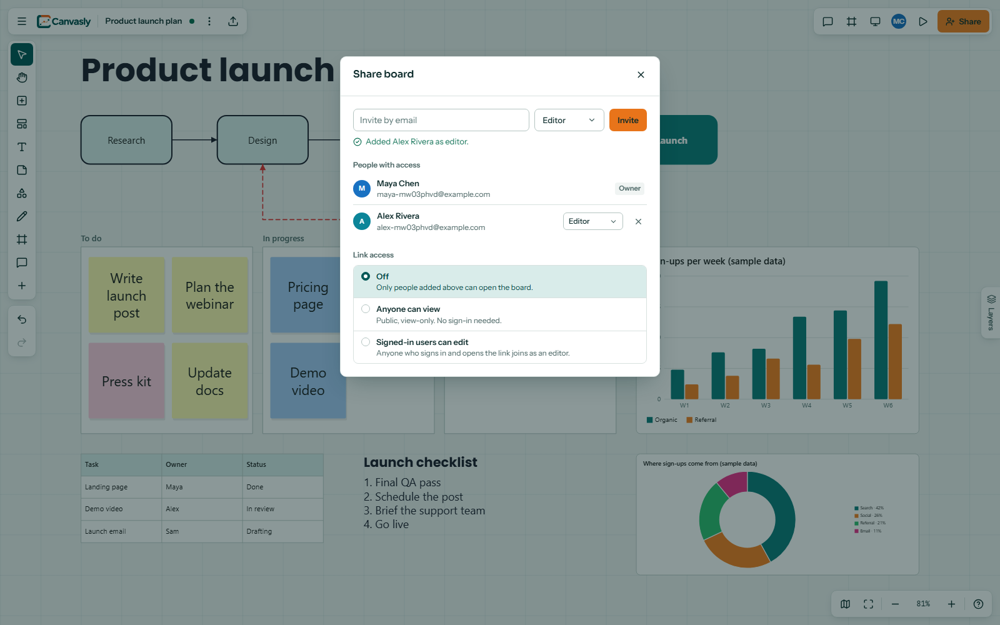<br><b>Sharing:</b> invites, roles and links</td>
    <td>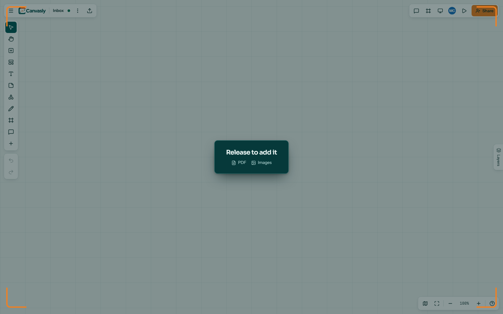<br><b>Files:</b> drag in images and PDFs</td>
  </tr>
  <tr>
    <td>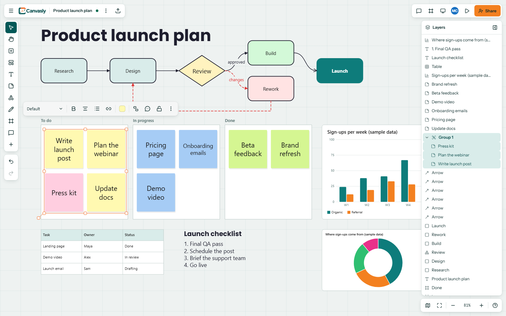<br><b>Layers:</b> everything on the board, with collapsible groups</td>
    <td>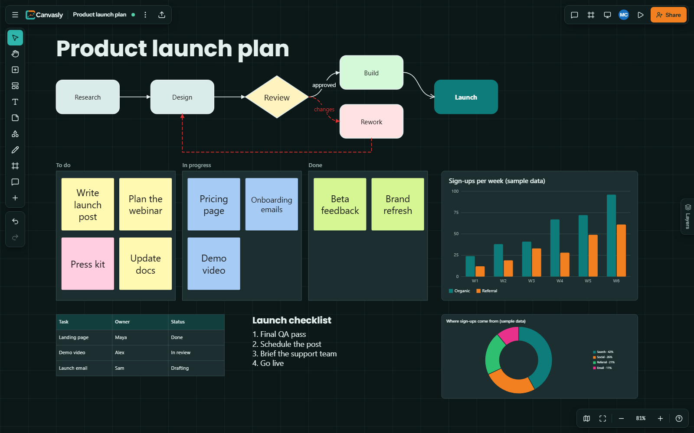<br><b>Dark mode:</b> across the whole app</td>
  </tr>
  <tr>
    <td>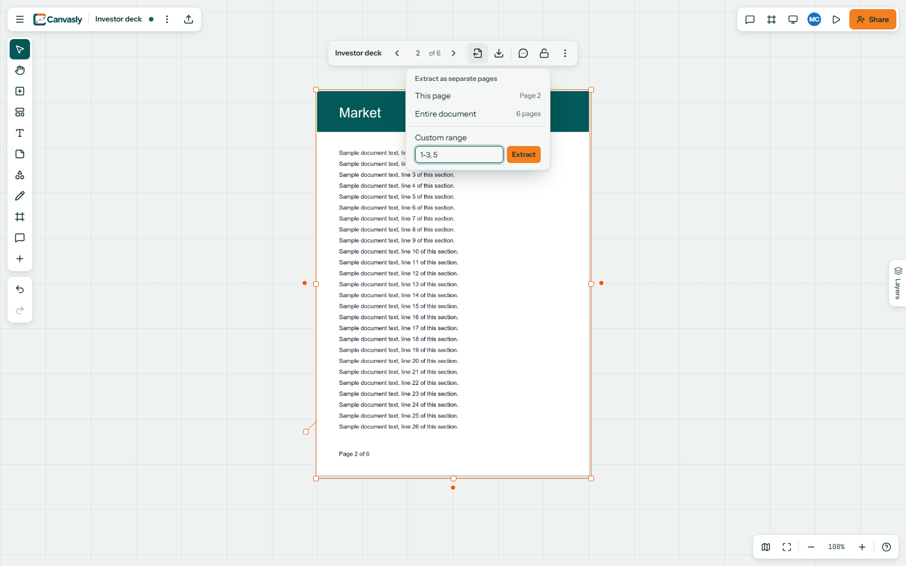<br><b>PDFs:</b> one object with page turning and extraction</td>
    <td>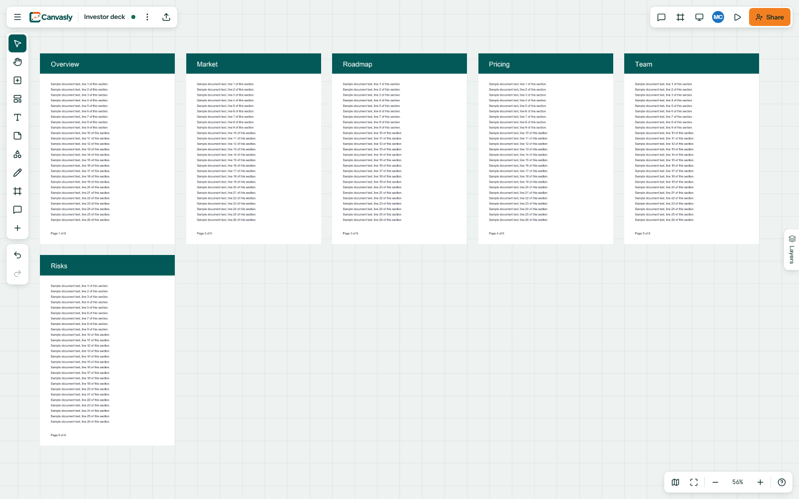<br><b>Extracted pages:</b> each one its own object</td>
  </tr>
  <tr>
    <td>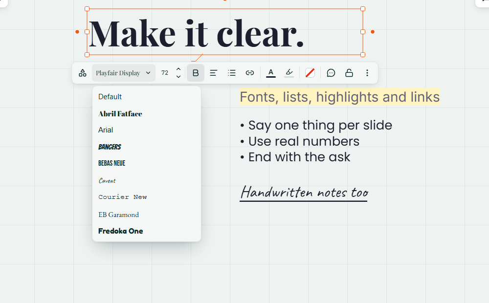<br><b>Text:</b> fonts and formatting</td>
    <td>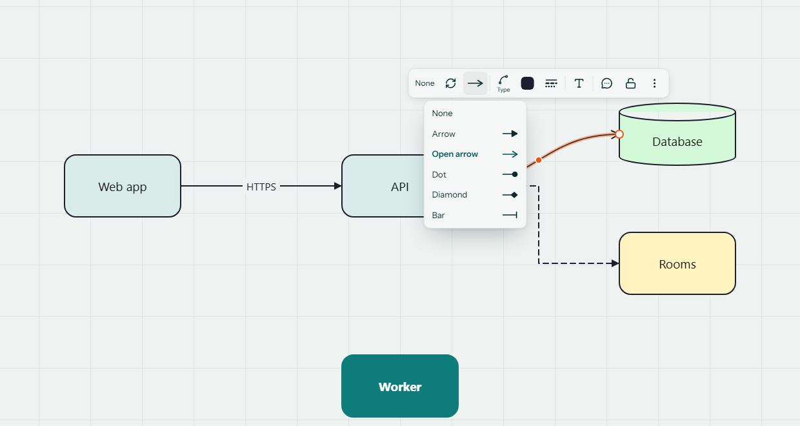<br><b>Lines:</b> routes, ends, styles and labels</td>
  </tr>
</table>

Screenshots come from the real app with demo content. Regenerate them with `pnpm --filter @canvasly/web screenshots`.

## Architecture

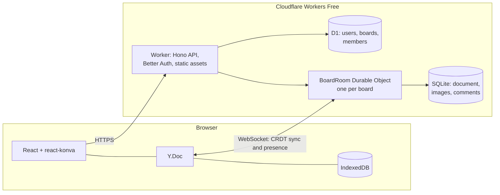

The [architecture notes](docs/ARCHITECTURE.md) cover sync, permissions, the data model and why each piece was chosen.

### Tech stack

| Layer         | Technology                                                                                                                                  |
| ------------- | ------------------------------------------------------------------------------------------------------------------------------------------- |
| Web app       | [React 19](https://react.dev), [Vite](https://vite.dev), [Tailwind CSS 4](https://tailwindcss.com), [Zustand](https://zustand.docs.pmnd.rs) |
| Canvas        | [Konva](https://konvajs.org) through react-konva, with R-tree hit testing                                                                   |
| Collaboration | [Yjs](https://yjs.dev) CRDTs, y-protocols over WebSockets, y-indexeddb for offline                                                          |
| Backend       | [Cloudflare Workers](https://developers.cloudflare.com/workers/), [Hono](https://hono.dev), Durable Objects with SQLite, D1                 |
| Auth          | [Better Auth](https://www.better-auth.com): email and password, optional Google, optional email through Resend                              |
| Documents     | [pdf.js](https://mozilla.github.io/pdf.js/) and [jsPDF](https://github.com/parallax/jsPDF), both loaded only when needed                    |
| Validation    | [Zod](https://zod.dev) schemas, shared between browser and server                                                                           |
| Quality       | Strict TypeScript, ESLint, Prettier, [Vitest](https://vitest.dev), [Playwright](https://playwright.dev), CodeQL                             |

## Quick start

You need [Node.js 22 or later](https://nodejs.org) and [pnpm](https://pnpm.io) (`npm install -g pnpm`).

```sh
git clone https://github.com/AnasSAV/Canvasly.git
cd Canvasly
pnpm install
pnpm dev
```

Open <http://localhost:5173> and create an account. The first run sets up a local database and config, with no Cloudflare
account needed. To put it online, follow the [deployment guide](docs/DEPLOYMENT.md).

| Command                                   | What it does                                  |
| ----------------------------------------- | --------------------------------------------- |
| `pnpm dev`                                | Worker and web app together                   |
| `pnpm test`                               | Unit tests                                    |
| `pnpm --filter @canvasly/web test:e2e`    | Browser tests, on their own servers and ports |
| `pnpm lint` / `pnpm typecheck`            | ESLint / TypeScript in every package          |
| `pnpm format`                             | Prettier                                      |
| `pnpm --filter @canvasly/web screenshots` | Regenerate the screenshots in these docs      |

## Project layout

```text
apps/
  web/              React app: canvas, toolbars, panels, and the browser tests in e2e/
  worker/           Cloudflare Worker: API, auth, the BoardRoom Durable Object, D1 migrations
packages/
  shared/           Schemas, geometry, Yjs helpers, permissions, templates (published as a package)
docs/               Architecture, deployment, user guide, screenshots
scripts/            Repository tools
```

## The package

The core of Canvasly is published as
[`@anassav/canvasly-shared`](https://github.com/AnasSAV/Canvasly/pkgs/npm/canvasly-shared): board schemas, line routing,
Yjs helpers, permissions and templates, with types, and no DOM dependency. Its
[README](packages/shared/README.md) has install steps and examples.

## Roadmap

These are known limits, in rough priority order. Suggestions are welcome in
[issues](https://github.com/AnasSAV/Canvasly/issues).

- [ ] Formatting selected words, rather than the whole text of an object
- [ ] Reordering in the layers panel by dragging, and nested groups
- [ ] Dragging table columns to resize them
- [ ] Elbow lines that route around other shapes
- [ ] Word, Excel and PowerPoint files
- [ ] Selectable text in PDFs
- [ ] Freeing storage when an image is deleted

## Contributing

Bug reports and pull requests are welcome. [Contributing](CONTRIBUTING.md) covers setup and conventions, and please see the
[code of conduct](CODE_OF_CONDUCT.md). To report a security problem, follow the [security policy](SECURITY.md) instead of
opening an issue.

## License

[MIT](LICENSE) © Anas Hussaindeen
