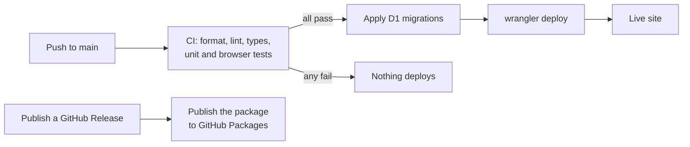

# Deployment

How to run your own Canvasly on Cloudflare's **Workers Free** plan. It's free and needs no payment method. For running it
locally, see [Contributing](../CONTRIBUTING.md).



## One-time setup

Everything below is free and needs no payment method.

1. The app is served at **https://canvasly.anas-hussaindeen.com** (`routes` in
   [`wrangler.jsonc`](../apps/worker/wrangler.jsonc), `custom_domain: true`). The domain's DNS is on Cloudflare,
   so `wrangler deploy` creates the DNS record and TLS certificate automatically; the `workers.dev` URL is
   disabled so there's a single origin. To use another (sub)domain, change the route pattern and
   `vars.BETTER_AUTH_URL` — the zone must be on the same Cloudflare account.
2. Log in (with the account that owns the domain): `pnpm --filter @canvasly/worker exec wrangler login`
3. Create the D1 database and copy the printed `database_id` into
   [`apps/worker/wrangler.jsonc`](../apps/worker/wrangler.jsonc):
   ```sh
   pnpm --filter @canvasly/worker exec wrangler d1 create canvasly
   ```
4. Apply migrations to it: `pnpm db:migrate:remote`
5. Set production secrets (each command prompts for the value):
   ```sh
   cd apps/worker
   pnpm exec wrangler secret put BETTER_AUTH_SECRET     # e.g. output of: openssl rand -base64 32
   pnpm exec wrangler secret put GOOGLE_CLIENT_ID       # optional, see "Google sign-in" below
   pnpm exec wrangler secret put GOOGLE_CLIENT_SECRET   # optional
   pnpm exec wrangler secret put RESEND_API_KEY         # optional, see "Email" below
   ```

### Google sign-in

Free; no Google billing account needed.

1. [Google Cloud Console](https://console.cloud.google.com/) → create a project → **APIs & Services →
   OAuth consent screen**: External, app name "Canvasly", your support email; scopes `email`,
   `profile`, `openid` (no verification needed for these). Publish the app ("In production") so any
   Google account can sign in, not just test users.
2. **Credentials → Create credentials → OAuth client ID → Web application**. Authorized redirect URIs:
   `https://canvasly.anas-hussaindeen.com/api/auth/callback/google` (and
   `http://localhost:5173/api/auth/callback/google` for local dev).
3. Store the client id and secret with the `wrangler secret put` commands above (or in `.dev.vars`
   locally). The "Continue with Google" button appears once both are set.

A Google sign-in for an email that already has an _unverified_ password account is refused (Better Auth
won't link into an account whose email ownership isn't proven); the sign-in page explains this.

### Email (Resend)

Cloudflare's Email Service can't send to arbitrary recipients on the Workers Free plan, so Canvasly uses
[Resend](https://resend.com)'s free tier (3,000 emails/month, 100/day) over HTTPS.

1. Create a Resend account → **Domains → Add domain** `canvasly.anas-hussaindeen.com` → add the DNS
   records it shows in the Cloudflare dashboard for `anas-hussaindeen.com` (or use Resend's Cloudflare
   auto-configure). They only add records under `canvasly.…`; nothing else on the domain changes.
2. **API Keys → Create** with _Sending access_ restricted to that domain, then
   `pnpm exec wrangler secret put RESEND_API_KEY` (from `apps/worker`).

With a key set, email/password sign-ups must confirm their address (verification email), "Forgot
password?" sends reset links, invites are emailed, and confirming an address claims boards that were
shared with it. Without a key (local dev, CI) emails are printed to the wrangler log and verification is off.
The sender is `vars.EMAIL_FROM` in [`wrangler.jsonc`](../apps/worker/wrangler.jsonc).

## Deploy

**Manually:** `pnpm cf:deploy` (builds the SPA, then `wrangler deploy` uploads the Worker, static assets
and Durable Object class). Run `pnpm db:migrate:remote` first whenever a new migration is added.

**From GitHub Actions:** [`ci.yml`](../.github/workflows/ci.yml) runs format/lint/typecheck/unit/e2e on
every push and PR; on `main` it then applies D1 migrations and deploys. The deploy job is skipped until
these repository secrets exist (Settings → Secrets and variables → Actions):

| Secret                  | Value                                                                                                                |
| ----------------------- | -------------------------------------------------------------------------------------------------------------------- |
| `CLOUDFLARE_API_TOKEN`  | My Profile → API Tokens → Create Token → "Edit Cloudflare Workers" template, plus **Account → D1 → Edit** permission |
| `CLOUDFLARE_ACCOUNT_ID` | Shown on the Workers & Pages overview page                                                                           |

Runtime secrets (`BETTER_AUTH_*`, `GOOGLE_*`) stay in Cloudflare (step 5 above), not in GitHub.

## Free-tier limits we rely on

All daily limits reset at 00:00 UTC. On the Free plan nothing is ever billed — exceeding a limit makes
the affected operations fail until the reset.

| Resource               | Free limit                                     | How Canvasly uses it                                                                                                                                                        | If exceeded                                                                            |
| ---------------------- | ---------------------------------------------- | --------------------------------------------------------------------------------------------------------------------------------------------------------------------------- | -------------------------------------------------------------------------------------- |
| Worker requests        | 100,000 / day                                  | Only `/api/*` runs the Worker (API calls, WS upgrades, image fetches). The SPA's static files are free.                                                                     | `/api/*` returns 429 / error 1027 → can't sign in or open boards. The SPA still loads. |
| Worker CPU             | 10 ms / request                                | PBKDF2 (native) for passwords; no heavy work in the Worker                                                                                                                  | That request fails                                                                     |
| Static asset requests  | Unlimited                                      | HTML/JS/CSS                                                                                                                                                                 | —                                                                                      |
| DO requests            | 100,000 / day; incoming WS messages count 1/20 | ≤ 20 batched frames/s (doc + cursor in one frame) per _active_ user ≈ 3,600 req/hour → ~25+ active user-hours/day; idle clients ≈ 7 req/hour (presence renewal + heartbeat) | Board connections/messages fail; edits stay in the browser (IndexedDB) and sync later  |
| DO duration            | 13,000 GB-s / day                              | Hibernation: idle rooms are evicted while sockets stay open; no server timers                                                                                               | Durable Object calls fail                                                              |
| DO SQLite rows written | 100,000 / day                                  | ~1 row per 2 s of continuous editing per board (+ compaction); one row per image                                                                                            | Saves fail; clients keep edits locally and resend on reconnect                         |
| DO SQLite rows read    | 5,000,000 / day                                | Loading a board reads its snapshot chunks + log (compacted at 200 rows); presence-only wake-ups read nothing                                                                | Boards can't load                                                                      |
| DO storage             | 5 GB total (≈ 1 GB per object); 2 MB per row   | Yjs snapshots chunked < 1 MB; images ≤ 1 MB                                                                                                                                 | Writes fail                                                                            |
| D1 rows read           | 5,000,000 / day                                | Session (cookie-cached 5 min), board list, access checks                                                                                                                    | All D1 queries fail → sign-in and dashboard break                                      |
| D1 rows written        | 100,000 / day                                  | Sign-ups/sessions, board create/rename, thumbnail upserts (≤ 1 per 30 s while editing)                                                                                      | Writes fail                                                                            |
| D1 storage             | 500 MB per DB, 5 GB total; 2 MB per row        | Metadata + ~10–40 KB thumbnails                                                                                                                                             | Inserts fail until data is deleted                                                     |
