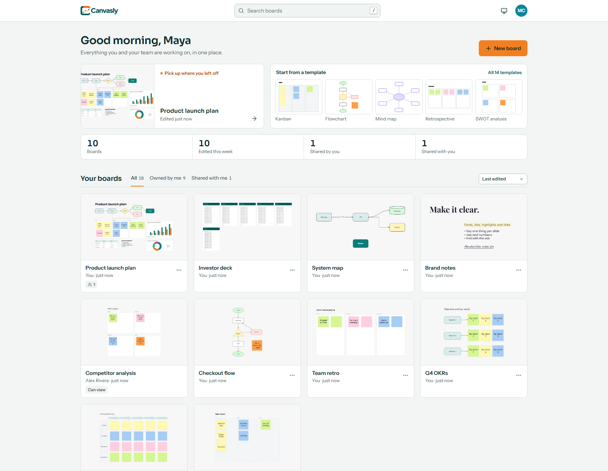
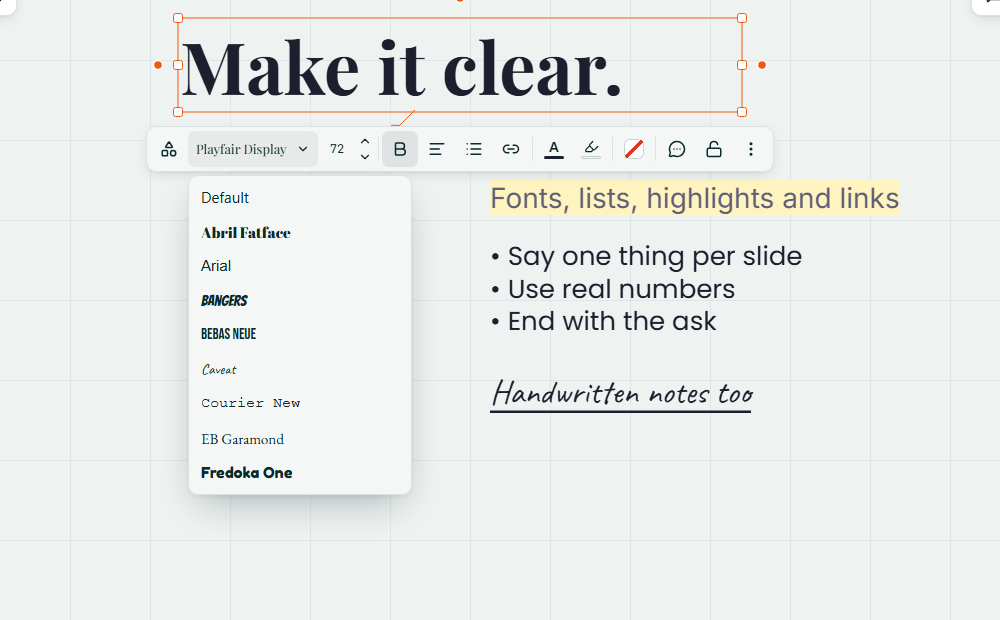
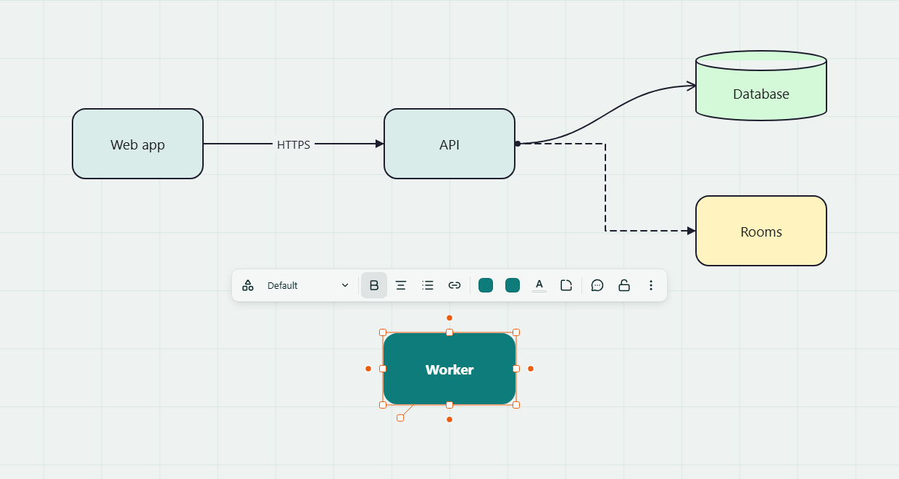
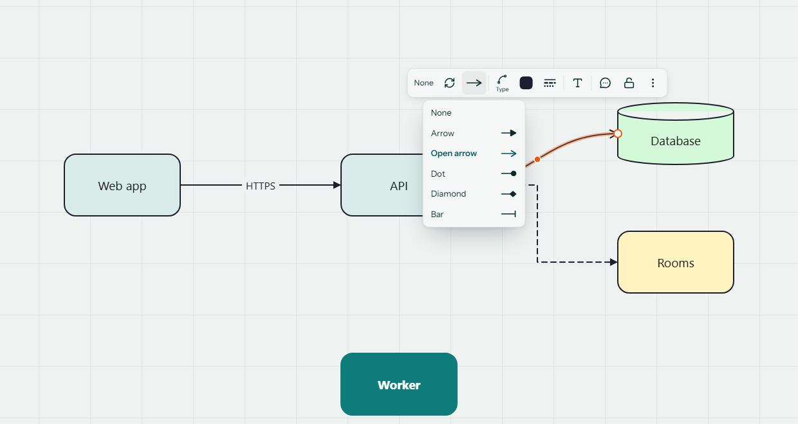
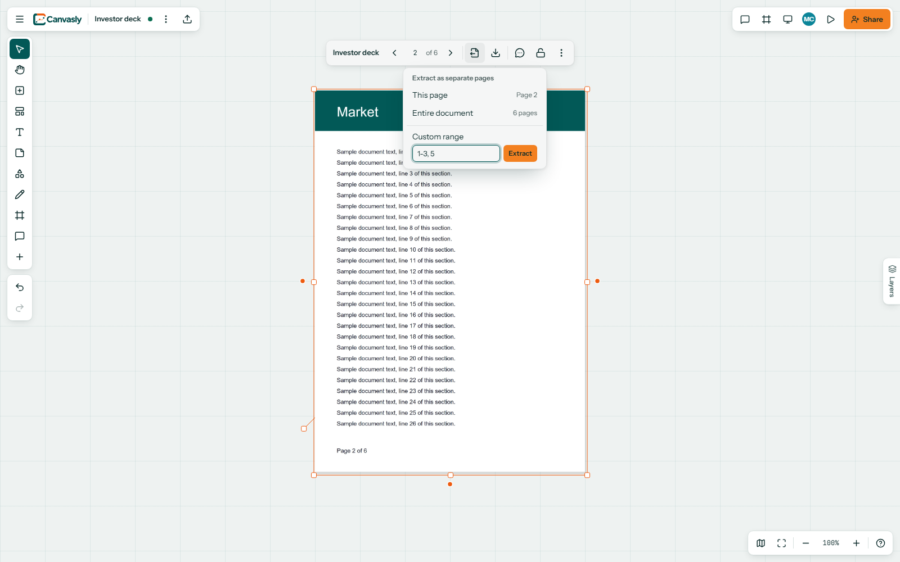
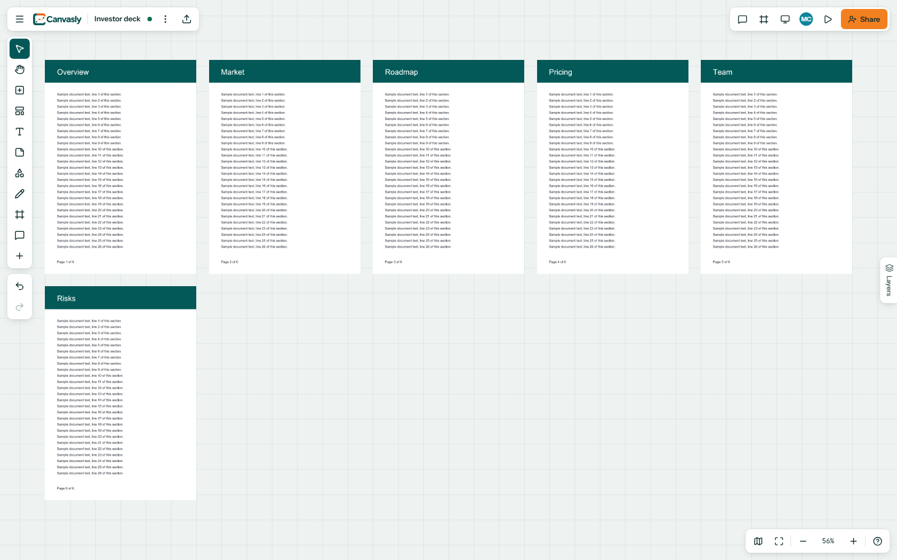
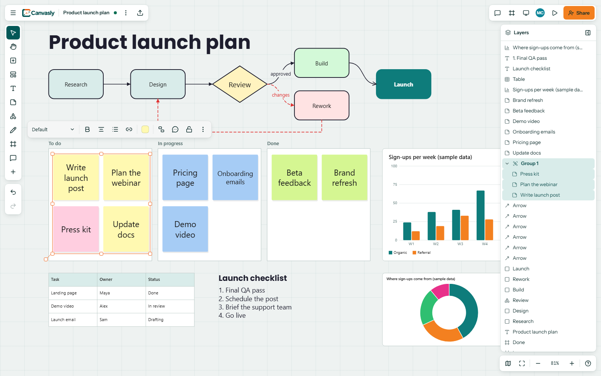
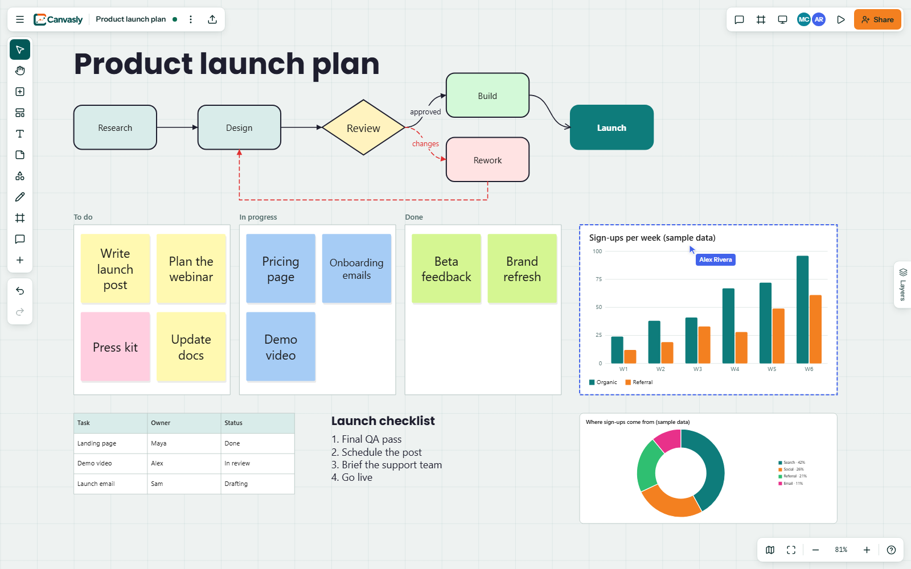
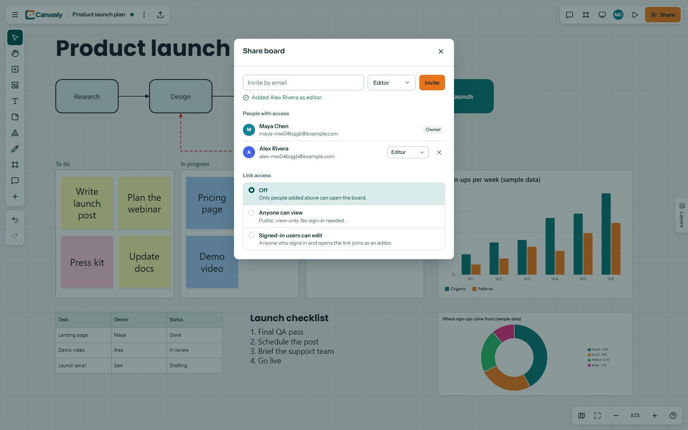
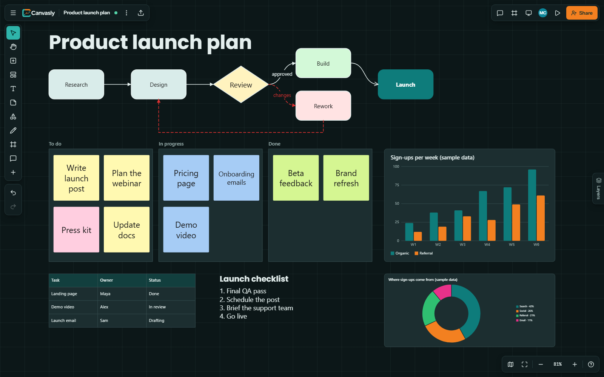

# User guide

Everything you can do on a board. To try it, [open Canvasly](https://canvasly.anas-hussaindeen.com) and create an account.

## The home page

Your boards, what you edited last, and a way to start from a template. Hover over a card to share a board without opening
it. Each card shows who else has access.

## Getting around

| Do this                                   | To                                              |
| ----------------------------------------- | ----------------------------------------------- |
| Scroll the mouse wheel                    | Zoom in and out, centered on the pointer        |
| Drag with the right button                | Pan                                             |
| Hold Space and drag                       | Pan                                             |
| Right-click                               | Open the board or object menu                   |
| Click ⋮ → Preferences → Mouse or trackpad | Switch to scrolling to pan and pinching to zoom |

## Text

Press `T` and click. The box fits your words as you type, and dragging a side handle fixes its width so that the text wraps.
Select it to get 28 fonts, size, bold, italic, underline, strikethrough, alignment, lists, links, color, highlight and a
background. Stickies and shapes share most of these.

Formatting applies to all the text in an object, rather than to selected words.

## Shapes and lines

Select a shape and drag one of the blue dots to draw a curved arrow. Let go on or near another shape and it attaches to its
nearest side. Click a dot instead to add a connected copy on that side.

Select a line to change its route (straight, elbow or curved), either end, its dashes, thickness and color, or to add text.
Drag the middle handle to bend it, and double-click the handle to straighten it. Rectangles and other straight-sided
shapes have a corner radius in their toolbar.

## Drawing

Press `P` for the pen panel: a pen and highlighter with three presets you can recolor, smart drawing that turns a sketch
into a clean shape, an eraser that cuts strokes where it touches them, a stroke eraser that removes them whole, and a
lasso for selecting by drawing around things.

## PDFs and images

Drag files onto the board, paste them, or use the upload button. A PDF becomes one object with page turning.
**Extract pages** turns the page on show, a custom range like `1-3, 5, 8-`, or the entire document into separate objects you
can move and resize on their own:

Up to 100 pages and 100 MB per PDF. Pages are stored as images, so their text can't be selected or searched. Word, Excel and
PowerPoint files aren't supported.

## Layers

The tab on the right edge lists everything on the board in stacking order, with what's on top first, and groups as folders
that collapse. Click a row to select it, even a single member of a group, double-click to zoom to it, or double-click a group
to rename it.

Drag a row up or down to change what's on top, or press Alt + up or down with the row focused. Selected rows move together.
Drop a row between a group's rows to add it to the group, or drag it out to take it back out; just below a group's last row,
how far in you drop decides which. Frames always stay beneath everything else, since they hold what's on them.

## Working together

Share a board from its card on the home page or the Share button on the board:

Everyone sees each other's cursors and selections live. Click someone's avatar to follow their view. Undo only ever undoes
your own changes, and edits made offline sync when you reconnect.

## Pasting from other apps

Copy something in another app and press `Ctrl+V` on the board. Styled content keeps its text, shapes and images.

From **Canva**, text and shapes arrive in their original positions with their styles. Two limits come from what Canva puts
on the clipboard: pictures arrive as gray boxes showing where they go, because it doesn't include the image files, and only
Poppins is matched by name so far, with other fonts using the default.

## Dark mode

The theme button cycles through system, light and dark. Exports always use the light theme.

## Keyboard shortcuts

| Key                             | Action                                      |
| ------------------------------- | ------------------------------------------- |
| V / H                           | Select / Hand                               |
| N / T                           | Sticky note / Text                          |
| R / O                           | Rectangle / Ellipse                         |
| L / A                           | Line / Arrow (connector)                    |
| P / E                           | Pen / Stroke eraser                         |
| I                               | Upload image                                |
| F / C                           | Frame / Comment                             |
| Space + drag, middle/right drag | Pan                                         |
| Wheel (mouse mode), pinch       | Zoom at cursor                              |
| Shift + wheel (mouse mode)      | Pan                                         |
| Right-click                     | Board or object menu                        |
| Shift+1 / Shift+0               | Zoom to fit / 100%                          |
| Alt+1                           | Show all                                    |
| G / Shift+C                     | Show grid / Show comments on board          |
| ?                               | Shortcuts help                              |
| Ctrl/⌘ B / I / U                | Bold / Italic / Underline                   |
| Ctrl/⌘ Shift X                  | Strikethrough                               |
| Ctrl/⌘ Shift > / <              | Bigger / Smaller text                       |
| Ctrl/⌘ Shift 8 / 7              | Bulleted / Numbered list                    |
| Ctrl/⌘ Z, Ctrl/⌘ Shift Z        | Undo / Redo                                 |
| Ctrl/⌘ D / A / C / X / V        | Duplicate / Select all / Copy / Cut / Paste |
| Ctrl/⌘ G, Ctrl/⌘ Shift G        | Group / Ungroup                             |
| Ctrl/⌘ Shift L                  | Lock / unlock                               |
| ] / [                           | Bring to front / Send to back               |
| Arrows (Shift = 10px)           | Nudge                                       |
| Enter / double-click            | Edit text                                   |
| Del / Backspace, Esc            | Delete, Deselect                            |
| Alt while dragging              | Disable alignment snapping                  |
| ← → / Space / Esc (presenting)  | Previous / next frame / exit                |
| Touch: drag, pinch, double-tap  | Pan, zoom, edit text                        |
